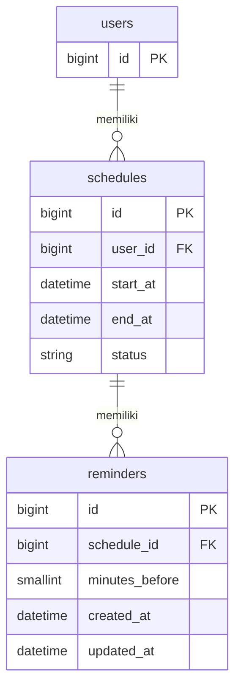

# ERD: Pengingat Jadwal

Satu tabel baru, `reminders`, milik tabel `schedules` yang sudah ada.

## Tabel `reminders`

| Kolom | Tipe | Null | Keterangan |
| --- | --- | --- | --- |
| id | bigint, PK | tidak | |
| schedule_id | bigint, FK ke `schedules.id` | tidak | `ON DELETE CASCADE`: jadwal dihapus, pengingatnya ikut hilang (AC 7) |
| minutes_before | unsigned smallint | tidak | menit sebelum jadwal mulai, 1 sampai 10080 |
| created_at, updated_at | datetime | ya | bawaan Laravel |

Kendala yang ditegakkan database:

- **UNIQUE (schedule_id, minutes_before)**: tidak ada dua pengingat sama pada satu jadwal (AC 3).
- **FOREIGN KEY schedule_id ... ON DELETE CASCADE** (AC 7).
- **NOT NULL** pada semua kolom isi, jadi pengingat tanpa jadwal atau tanpa menit tidak bisa tersimpan.

Kendala yang **tidak** bisa ditegakkan database dengan portabel, sehingga ditegakkan di aplikasi:

- Maksimal 3 pengingat per jadwal (AC 2). Dicek di dalam transaksi dengan mengunci baris jadwal, supaya dua permintaan bersamaan tidak sama-sama lolos.
- `remind_at` tidak boleh di masa lalu (AC 4), karena bergantung pada waktu sekarang.
- Rentang 1 sampai 10080 (AC 5), divalidasi di aplikasi.

## Keputusan desain

`remind_at` **tidak disimpan**, hanya `minutes_before`. Kalau waktu mulai jadwal diubah, `remind_at` yang tersimpan akan basi dan harus ikut diperbarui. Dengan menyimpan selisih menit, nilainya selalu dihitung dari `start_at` terbaru.
